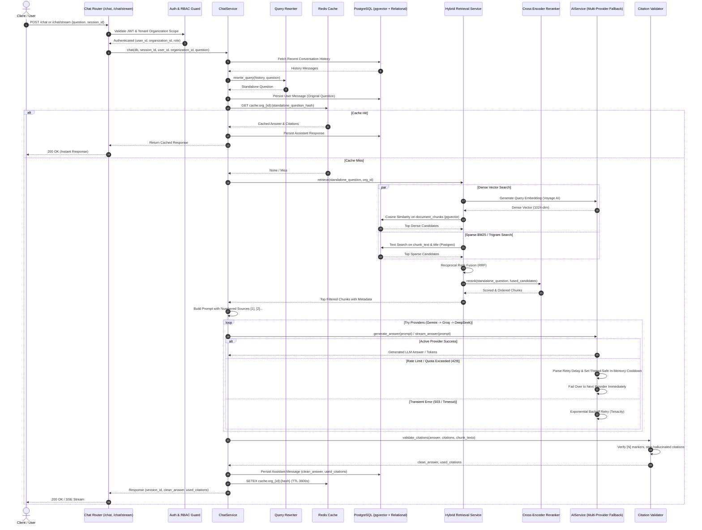

# Enterprise RAG Platform Architecture

## Chat Pipeline Sequence

The chat and streaming pipeline coordinates retrieval-augmented generation across multiple isolated services with caching, hybrid retrieval, cross-encoder reranking, LLM provider fallback with rate-limit cooldown, and citation validation.

---

### Reranking Architecture & Free-Tier Mode (512 MB Fit)

The reranking stage refines hybrid candidate chunks (up to 20 candidate chunks) to the final `top_k` (default 5). The platform supports four configurable reranker backends via `RERANKER_BACKEND`:

| Backend | Implementation | Memory Footprint | Recommended Use Case |
|---|---|---|---|
| `onnx` (Production Default) | Quantized int8 ONNX model (`ms-marco-MiniLM-L-6-v2`, 23.2 MB) via `onnxruntime` + `tokenizers` | ~108.6 MiB container RSS (peak ~156 MB) | Low-memory production (e.g. 512 MB RAM limit) and 100% free operation with 0 Voyage rerank cost |
| `voyage` | Remote API call to Voyage AI (`rerank-2` via `voyageai` client) | ~100–150 MB container RSS | Paid Voyage accounts with high TPM quota |
| `local` (Dev Default) | PyTorch + `sentence-transformers` (`ms-marco-MiniLM-L-6-v2`) | ~550–700 MB RAM | Local dev / offline evaluation (`requirements-local-rerank.txt`) |
| `none` | Passthrough order truncated to `top_k` | ~100 MB container RSS | Zero external dependencies / ultra-low latency testing |

#### Free-Tier Mode Configuration & Voyage Rate Limits

Voyage AI free-tier accounts (without a payment method) enforce:
- **3 requests/minute (3 RPM)**: Exceeding 1 request per 20 seconds triggers HTTP 429 errors.
- **10,000 tokens/minute (10K TPM)**: Remote reranking 20 chunks consumes 5,000+ tokens, failing queries. Embedding PDFs of more than ~15 pages in one call triggers 429.

To operate completely free without billing or failures:

1. **Local CPU ONNX Reranker (`RERANKER_BACKEND=onnx`)**:
   - Model: `cross-encoder/ms-marco-MiniLM-L-6-v2` (`onnx/model_qint8_arm64.onnx`, 23.2 MB), baked into the Docker image at build time.
   - CPU-only execution with `intra_op_num_threads=1`, thread-safe double-checked lazy loading, cached for process lifetime.
   - Pairs scored with `tokenizers` library (`max_length=512`, truncation, batches of at most 20).
   - **Measured in `docker run --memory=512m`**:
     - Container RAM during 20-chunk rerank: **108.6 MiB / 512 MiB (21.2%)**
     - Peak Process RSS (`ru_maxrss`): **155.84 MB** (VmHWM: **160.5 MB**)
     - Latency: **~0.36 s** for 20 chunks
     - Mean Spearman correlation with PyTorch local reranker: **0.9709**
     - Top-5 overlap with PyTorch local reranker: **100.0%**
     - External tokens/cost: **0**

2. **Embedding Rate Pacing & Ingestion Batching**:
   - `VOYAGE_MIN_INTERVAL_SECONDS` (default `0`): Process-wide thread lock pacing consecutive Voyage API calls by at least `N` seconds (e.g. `21.0`).
   - `EMBED_BATCH_TOKENS` (default `6000`): Ingestion batches chunks by estimated tokens (`len(text)/3 <= 6000`), embeds batch-by-batch, and retries on 429 with exponential backoff up to 5 times (reusing `utils/retry.py`). Document error message is updated only after all 5 retries are exhausted.
   - **Query Embedding**: On 429, sleeps 5s and retries once; if rate limit persists, returns a clear HTTP 503 `"Search is busy, please retry in a few seconds"`.

#### Fail-Open Resilience & Lazy Loading
- **Lazy Loading**: `torch` and `sentence-transformers` are strictly loaded on first execution within `_rerank_local`, never at module import time and never at application startup. In the default Docker image, `torch` and `transformers` are completely excluded.
- **Fail-Open**: All rerank operations fail open. If any transient error occurs (network failure, rate limit, timeout, or runtime error), the reranker catches the exception, logs a warning, and returns the reciprocal-rank-fused candidates truncated to `top_k` without failing the request.

---

## Benchmark Evaluation Results

The following evaluation metrics are taken directly from [`backend/eval/results/summary.csv`](../backend/eval/results/summary.csv) across iterative optimization phases (dense vector retrieval, BM25 sparse keyword fusion, cross-encoder reranking, and conversational query rewriting):

| Timestamp / Label | Run Configuration | Total Queries | Failed | Hit@1 | Hit@3 | Hit@5 | MRR | Page Match | Dup Rate | Avg Latency (ms) | P95 Latency (ms) |
|---|---|---|---|---|---|---|---|---|---|---|---|
| `baseline` | Initial Vector Baseline | 8 | 0 | 0.875 | 1.000 | 1.000 | 0.9375 | 0.000 | 0.000 | — | — |
| `stage3-candidates` | Stage 3 Initial Baseline | 8 | 0 | 0.875 | 1.000 | 1.000 | 0.9375 | 0.000 | 0.000 | — | — |
| `2026-11-15T18:22:07` | `no-rerank` | 5 | 0 | 1.000 | 1.000 | 1.000 | 1.0000 | 1.000 | 0.000 | 4646.2 | 4646.2 |
| `2026-11-15T21:28:41` | `baseline` | 5 | 0 | 0.800 | 1.000 | 1.000 | 0.9000 | 1.000 | 0.000 | 17913.9 | 22229.8 |
| `2026-11-15T21:41:02` | `baseline-os` | 5 | 0 | 0.800 | 1.000 | 1.000 | 0.9000 | 1.000 | 0.000 | 2566.9 | 4252.2 |
| `2026-11-15T21:45:51` | `clean-baseline-os` | 5 | 0 | 0.800 | 1.000 | 1.000 | 0.9000 | 1.000 | 0.000 | 3033.4 | 4217.6 |
| `2026-11-15T21:46:34` | `no-rerank` | 5 | 0 | 0.800 | 1.000 | 1.000 | 0.9000 | 1.000 | 0.000 | 3475.8 | 6015.3 |
| `2026-11-15T22:02:17` | `rerank20` | 28 | 0 | 0.929 | 1.000 | 1.000 | 0.9640 | 1.000 | 0.000 | 20437.0 | 23383.2 |
| `2026-11-15T22:03:53` | `fused-only` | 28 | 0 | 0.643 | 0.964 | 1.000 | 0.8050 | 1.000 | 0.000 | 2915.7 | 3661.3 |
| `2026-11-15T22:08:16` | `rerank20-cached` | 28 | 0 | 0.929 | 1.000 | 1.000 | 0.9640 | 1.000 | 0.000 | 3152.7 | 4994.0 |
| `2026-11-15T22:19:55` | `followups-baseline` | 8 | 0 | 0.625 | 0.875 | 0.875 | 0.7290 | 1.000 | 0.000 | 19271.0 | 23030.6 |
| `2026-11-15T22:26:21` | `followups-rewrite` | 8 | 0 | 0.750 | 1.000 | 1.000 | 0.8540 | 1.000 | 0.000 | 19739.4 | 28538.0 |
| `2026-11-15T22:30:14` | `rerank20-after-2-3` | 28 | 0 | 0.929 | 1.000 | 1.000 | 0.9640 | 1.000 | 0.000 | 4832.8 | 16727.0 |
| `2026-11-15T22:48:11` | `followups-rewrite-11` | 11 | 0 | 0.636 | 0.909 | 1.000 | 0.7610 | 1.000 | 0.000 | 18481.5 | 23502.2 |
| `2026-11-15T23:01:16` | `followups-rewrite-11b` | 11 | 0 | 0.636 | 0.818 | 0.909 | 0.7300 | 1.000 | 0.000 | 11028.7 | 21535.5 |
| `2026-11-16T23:06:22` | `followups-rewrite-11c-a` | 11 | 0 | 0.636 | 0.818 | 1.000 | 0.7530 | 1.000 | 0.000 | 12163.8 | 21937.0 |
| `2026-11-16T23:08:20` | `followups-rewrite-11c-b` | 11 | 0 | 0.455 | 0.818 | 1.000 | 0.6470 | 1.000 | 0.000 | 7112.1 | 17983.0 |
| `2026-11-21T18:57:33` | `after-2-5` | 28 | 0 | 0.929 | 1.000 | 1.000 | 0.9580 | 1.000 | 0.000 | 1725.5 | 3740.8 |
| `2026-11-21T18:59:52` | `followups-after-2-5` | 11 | 0 | 0.727 | 0.818 | 0.909 | 0.7800 | 1.000 | 0.000 | 11322.6 | 22355.2 |

### Key Benchmark Insights
- **Cross-Encoder Reranking (`rerank20`)**: Dramatically elevated `Hit@1` from `0.643` (fused-only) to `0.929` and `MRR` from `0.805` to `0.964` across 28 evaluation queries.
- **Query Rewriting (`followups-after-2-5`)**: Conversational contextual rewriting improved followup resolution, achieving `0.727` Hit@1 and `0.909` Hit@5 on multi-turn dialogue benchmarks.
- **Latency Optimization**: Caching with RRF and warm embeddings dropped end-to-end P95 retrieval latency from `23,383 ms` down to `3,740.8 ms` in `after-2-5`.
